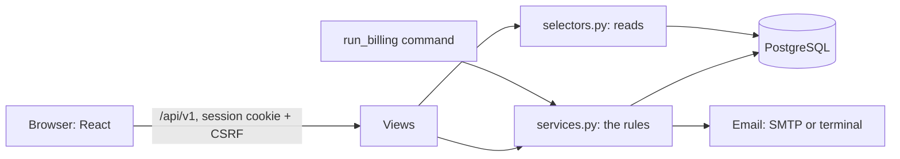
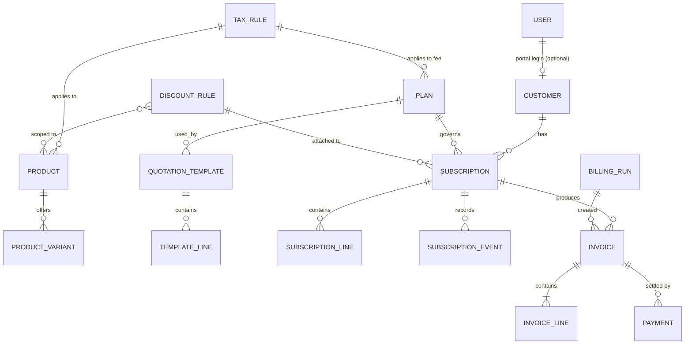

# Architecture

Concord is a **modular monolith**: one Django project, one PostgreSQL database, one React app.

Microservices would mean splitting invoices and payments across services, and those need to change together in a single transaction. A monolith with clear modules keeps that simple while the code stays organised.



In development the browser only talks to Vite, which forwards `/api` to Django. That means one origin, so session cookies and CSRF work without CORS.

## Apps

Dependencies run in one direction only, which prevents circular imports:

```text
common <- accounts <- catalog <- subscriptions <- billing <- reports
```

| App | Holds |
|---|---|
| `common` | Money helpers, permissions, number sequences, email, the error format |
| `accounts` | User, Customer, signup, login, password reset, staff |
| `catalog` | Products, variants, plans, tax rules, discount rules, quotation templates |
| `subscriptions` | Subscription, lines, history, the state machine, billing period arithmetic |
| `billing` | Invoices, payments, billing runs, pricing |
| `reports` | Read-only finance numbers. It has no tables of its own |

Activating a subscription creates an invoice, but `subscriptions` can't depend on `billing`. So the `activate` endpoint lives in `billing`, which calls into `subscriptions`.

## Where code goes

| Layer | Holds | Must not |
|---|---|---|
| `services.py` | Every state change and rule, inside transactions | Know about HTTP |
| `selectors.py` | Who can see what, and complex reads | Write data |
| `pricing.py`, `periods.py` | Pure calculations, easy to test by hand | Touch the database |
| Serializers | Input shape and output format | Hold business rules |
| Views | Permissions, calling one service, returning a response | Calculate anything |

**A status can never be set directly.** It changes only through named actions like `POST /subscriptions/7/confirm`, which all pass through one table of allowed moves.

## Data model



In plain terms: products and plans are the menu. A subscription is the customer's order, including while it's still a quote. An invoice is a snapshot of that order for one billing period, with names, prices and tax rates copied onto it so later catalog changes can't rewrite it.

## Rules the database enforces itself

These hold even if the application code has a bug:

| Constraint | What it stops |
|---|---|
| `invoice_one_live_per_period` | Two live invoices for one subscription and period. Cancelled ones don't count, so a period can be reissued |
| `invoice_paid_within_total` | Paying more than an invoice's total |
| `discount_within_usage_limit` | A discount going past its limit |
| `user_email_lowercase` with a unique index | Two accounts whose emails differ only by case |
| Unique invoice and subscription numbers, payment idempotency key | Duplicates, including a double-clicked payment |

## Access

- **Roles:** `common/permissions.py` decides which role reaches which endpoint.
- **Ownership:** `subscriptions_visible_to` and `invoices_visible_to` filter what a customer can see. Someone else's record isn't in the results, so requesting it returns 404 and doesn't reveal that it exists.
- The frontend hides what a role can't use, but only for convenience. The server enforces everything.

## Performance

- Indexes follow real queries, such as status and next billing date for finding what's due.
- `amount_paid` and `recurring_subtotal` are stored rather than added up each time. Only locked service functions change them.
- Lists are paginated on the server, and a test fails if a list starts running one query per row.
- Overdue is never stored. It's worked out from status and due date, so it can't go stale.
