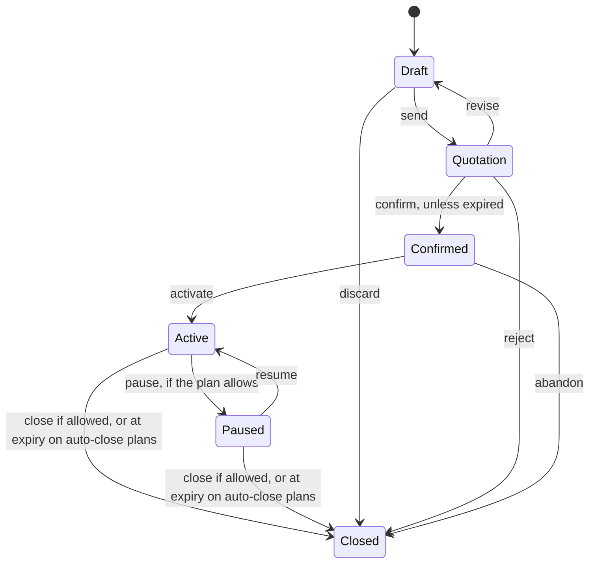

# Workflows

## Signup and access

1. A customer signs up with a unique email and a password of more than eight characters, with an uppercase letter, a lowercase letter and a special character.
2. Signup creates the login and customer record together. It can only ever create a customer.
3. Forgotten passwords use an emailed link that works once and expires in an hour. The response is the same whether or not the account exists.
4. Only the admin can add staff.

## Launching a plan

1. The admin adds a product with its type, sales price, cost price, notes and tax rule, plus any variants.
2. The admin creates a plan: price, how often it bills, minimum quantity, availability dates, term length, and whether it closes by itself, closes early, pauses or renews.

**How prices combine:** the plan price becomes a "plan fee" line, and each product line charges sales price plus the variant's extra. A plan's price can be 0 if the products carry the whole cost.

## Quote to subscription



1. Staff start from a template, which copies its plan and lines and sets the validity period, or build the quote by hand.
2. Terms and lines can only be edited in Draft.
3. Staff send the quotation. The customer can accept it in the portal, or staff can confirm it. An expired quotation can't be confirmed.
4. Activating sets the billing schedule and creates the first invoice if the start date has arrived. Payment doesn't decide activation, because customers on payment terms start before they pay.

## Billing day

For each subscription that's active and due, in its own transaction:

```text
lock the subscription (skip it if another run holds it)
while the next billing date has arrived and is before expiry:
    work out the period from the anchor date
    lock the discount rule, check dates and usage limit
    price the lines: quantity x price, minus discount, then tax
    take the next invoice number
    create the invoice and its lines, as a draft
    count the discount use, if it changed this invoice
    move the billing date forward
then close expired subscriptions on auto-close plans
```

- One failing subscription is recorded and doesn't stop the rest.
- Each run is logged with what it created, skipped or failed on.
- If nothing is due, a run creates nothing, however many times it's repeated.

**Worked example:** 2 x ₹999 + 1 x ₹299 = ₹2,297.00. Tax at 18% = ₹413.46. Total ₹2,710.46.

## Invoices

`Draft → Confirmed → Paid`, or `Draft/Confirmed → Cancelled` if no payments have been recorded.

- **Confirm** makes it visible to the customer and payable.
- **Send** emails it, and is only recorded as sent if the email actually went.
- **Cancel** keeps it on record and returns any discount use.
- **Reissue** creates a correct replacement for a cancelled invoice's period.
- **Paid** is never chosen by anyone. It's set when the balance reaches zero.

## Discounts

1. Only the admin creates rules. Staff attach a rule to a subscription.
2. The rule appears on the next invoice by itself.
3. It's checked again for every invoice, against its dates, usage limit and minimums.
4. If a minimum isn't met, that invoice has no discount and no use is counted.

## Pause, resume, renew, close

- **Pause:** no invoices while paused.
- **Resume:** if the period already billed is still running, the schedule stays the same, so nobody pays twice for the same days. Otherwise billing restarts from today. Periods that passed while paused aren't billed.
- **Renew:** extends the expiry by one term on the same subscription and schedule.
- **Close:** stops future billing. Existing invoices stay as they are, with no refund.

## Payments

Staff record method, amount, date and note against a confirmed invoice. The invoice row is locked, so simultaneous payments can't overpay it. Each payment form carries a unique key, so a double click records one payment.
